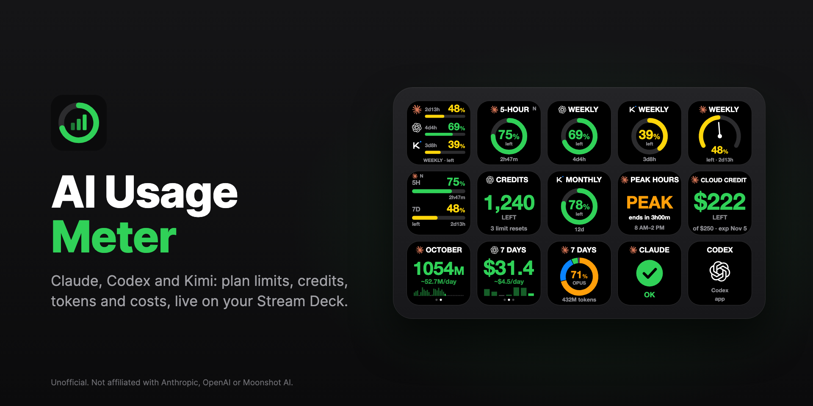
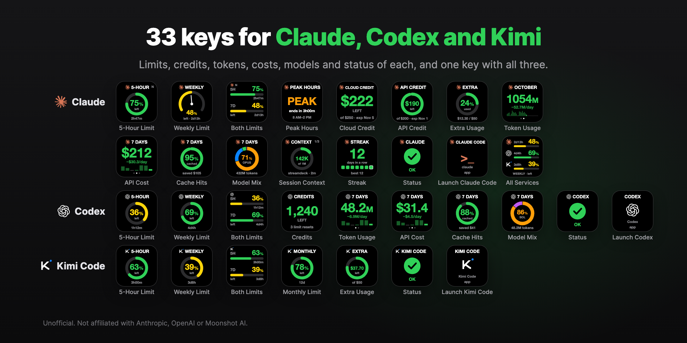
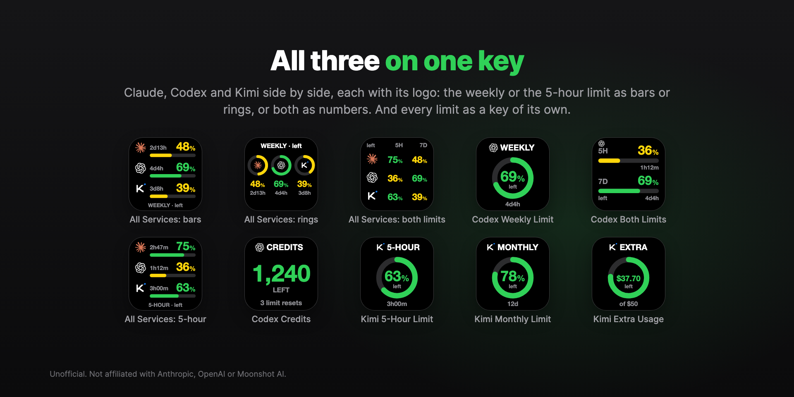
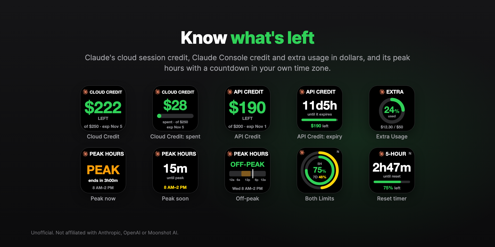
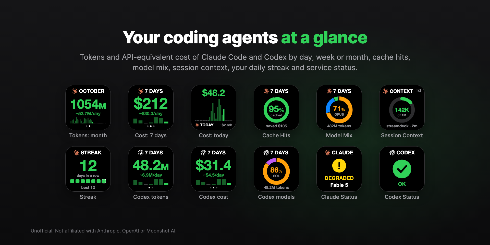
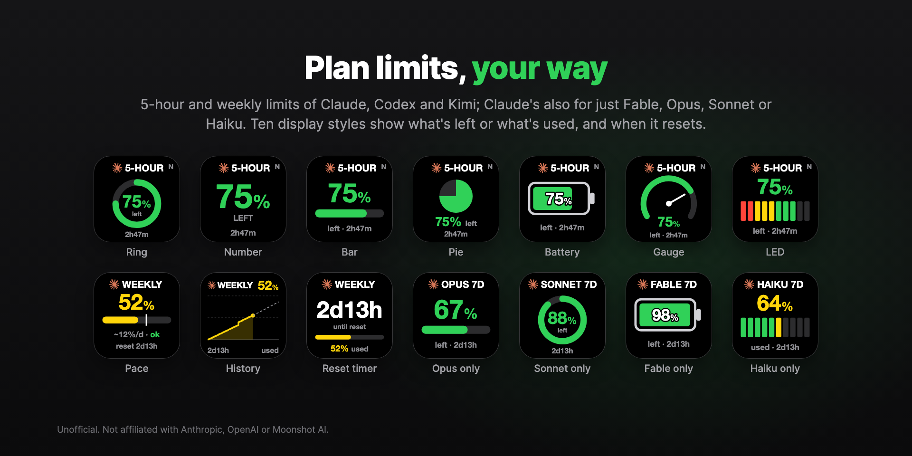
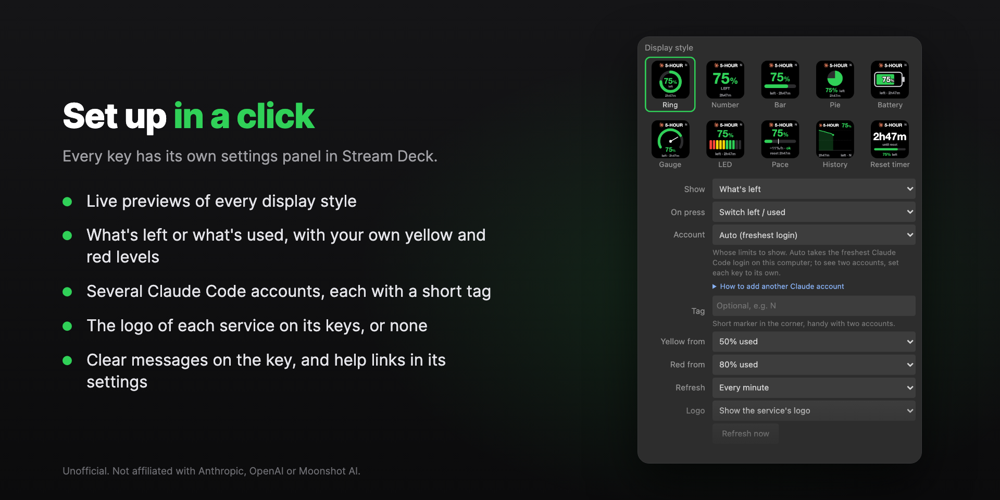

# AI Usage Meter

[](https://github.com/developerscompany/ai-usage-meter/actions/workflows/ci.yml)
[](https://github.com/developerscompany/ai-usage-meter/releases/latest)
[](LICENSE)


Your AI coding limits on Stream Deck. One plugin, 33 keys, three services: **Claude**, **Codex** and **Kimi Code**. See what is left of each plan before you hit a limit, what your work would cost through the API, and whether the service is up.



**[Download AI Usage Meter](https://github.com/developerscompany/ai-usage-meter/releases/latest/download/agency.rivo.ai-usage-meter.streamDeckPlugin)** · [Website](https://developerscompany.github.io/ai-usage-meter/) · [All releases](https://github.com/developerscompany/ai-usage-meter/releases) · [What's new](CHANGELOG.md) · [Українською](README.uk.md)

> Unofficial plugin by [Rivo Agency](https://rivo.agency). Not affiliated with or endorsed by Anthropic, OpenAI or Moonshot AI. Until version 4.0 it was called Usage Meter for Claude.

## Contents

- [What you get](#what-you-get)
- [Install](#install)
- [What each service needs](#what-each-service-needs)
- [Keys](#keys)
- [Display styles and logos](#display-styles-and-logos)
- [Settings of a key](#settings-of-a-key)
- [Where the numbers come from](#where-the-numbers-come-from)
- [Setup](#setup)
- [What the keys say](#what-the-keys-say)
- [Questions and answers](#questions-and-answers)
- [Privacy and security](#privacy-and-security)
- [What's next](#whats-next)
- [Development](#development)

## What you get



- **Plan limits** of Claude, Codex and Kimi Code: the 5-hour and the weekly one, what is left or used, and the time until the reset. Ten display styles, from a ring to a history chart.
- **All Services**: the three services side by side on one key.
- **Money**: Claude's cloud session credit, Claude Console credit and extra usage; Codex credits; Kimi's wallet of extra usage.
- **Tokens and costs** of Claude Code and Codex on this computer, by day, week or month, at API list prices; cache hits and model mix.
- **Status** of each service from its public status page, and keys that **start** Claude Code, Codex or Kimi Code.
- The **logo** of its service on every key, so a glance tells a Claude limit from a Codex one.

Everything runs on your computer. The plugin reads the logins your tools already keep, asks each service for your numbers, and sends nothing anywhere else.

## Install

1. Download **[`agency.rivo.ai-usage-meter.streamDeckPlugin`](https://github.com/developerscompany/ai-usage-meter/releases/latest/download/agency.rivo.ai-usage-meter.streamDeckPlugin)** from the latest release.
2. Double-click the file. Stream Deck installs the plugin. Later versions install the same way and keep your keys and their settings.
3. In Stream Deck's action list, open the **AI Usage Meter** category and drag the keys you want onto your Stream Deck.
4. Click a key to open its settings. They show a live preview of every display style; click one to use it.

**Requirements:** Stream Deck 6.9 or later on macOS 12+ or Windows 10+. The plugin is tested on macOS; Windows support is in the code but hasn't been tried on a real PC yet.

**Coming from Usage Meter for Claude 3.x** (or Rivo Claude Usage 2.x)? AI Usage Meter has a new plugin identifier, so Stream Deck installs it next to the old plugin instead of over it. Add your keys once from the new **AI Usage Meter** category, then remove the old plugin: right-click it in Stream Deck's plugin list and choose **Uninstall**. An Admin key you stored in the Keychain under the old name is still found.

## What each service needs

A key works as soon as its service is signed in on the same computer. Nothing is typed into the plugin.

| Service | What has to be on this computer | What you get |
| --- | --- | --- |
| **Claude** | [Claude Code](https://code.claude.com/docs/en/setup) signed in with a Pro or Max plan | limits, credits and extra usage of your account; tokens, costs, cache, models, context and streak from Claude Code's logs |
| **Codex** | Codex (the app or the CLI) signed in with a ChatGPT account | limits and credits of your account; tokens, costs, cache and models from Codex's logs |
| **Kimi Code** | the Kimi Code app signed in, or a Kimi Code API key [stored for the plugin](#your-kimi-code-login) | limits and extra usage of your account |

You only need the services you use: a key of a service that isn't set up says so, and the others don't mind.

## Keys

In Stream Deck's action list every key carries its service's name: **Claude 5-Hour Limit**, **Codex Weekly Limit**, **Kimi Monthly Limit**. A short press does what the table says (most of it can be changed under **On press**); holding a key for a moment refreshes it. A key that has only a message on it (no login yet, or a refused one) asks again when you press it.

### All services



| Key | Shows | Press | Hold |
| --- | --- | --- | --- |
| **All Services** | Claude, Codex and Kimi on one key, a row each: the weekly or the 5-hour limit as bars or rings, or both limits as numbers | switch left / used, or weekly / 5-hour | refresh |

A service whose plan has no weekly limit shows its monthly one in that place, marked `MO`. An orange dot by a service's logo means its login needs attention; a dimmed row has numbers that are no longer current. Choose which services the key shows under **Services**.

### Claude

| Key | Shows | Press | Hold |
| --- | --- | --- | --- |
| **5-Hour Limit** | the 5-hour session limit: left or used, and the time until it resets; `not on your plan` on an account that has none (verified Ultra accounts) | switch left / used | refresh |
| **Weekly Limit** | the weekly limit for all models, or just Fable, Opus, Sonnet or Haiku | the same | refresh |
| **Both Limits** | 5-hour and weekly limits on one key | the same | refresh |
| **Peak Hours** | whether it's peak time now (weekdays 5–11 AM Pacific) and when it ends or starts, in your time zone | next style | — |
| **Cloud Credit** | dollars left of your plan's cloud session credit, and when it expires | switch left / spent | refresh |
| **API Credit** | what's left of a Claude Console credit (such as $200 of promotional API credit) after your API spend | switch left / spent | refresh |
| **Extra Usage** | extra usage spent this month, out of your monthly limit | open the usage page | refresh |
| **Token Usage** | Claude Code tokens today, over 7 days or this month | next period | rescan |
| **API Cost** | what that usage would cost at Anthropic's API list prices | next period | rescan |
| **Cache Hits** | the share of input read from the prompt cache, and what it saved | next period | rescan |
| **Model Mix** | the share of Fable, Opus, Sonnet and Haiku | next period | rescan |
| **Session Context** | how full the context of your latest Claude Code sessions is | next session | rescan |
| **Streak** | days in a row with Claude Code | next style | rescan |
| **Claude Status** | service status from status.claude.com, naming the model in trouble (`DEGRADED · Fable 5`) | open the incident or status page | refresh |
| **Launch Claude Code** | opens a terminal running `claude` in a folder you choose, with any of your Claude accounts | launch | — |



### Codex

| Key | Shows | Press | Hold |
| --- | --- | --- | --- |
| **5-Hour Limit** | Codex's 5-hour limit on your ChatGPT plan; `not on your plan` where the plan only has a weekly one | switch left / used | refresh |
| **Weekly Limit** | Codex's weekly limit | the same | refresh |
| **Both Limits** | both on one key | the same | refresh |
| **Credits** | credits bought on top of the plan, and the limit resets your account can spend | open the Codex usage page | refresh |
| **Token Usage** | Codex tokens today, over 7 days or this month | next period | rescan |
| **API Cost** | what that usage would cost at OpenAI's API list prices | next period | rescan |
| **Cache Hits** | the share of input read from the prompt cache, and what it saved | next period | rescan |
| **Model Mix** | the share of each model family (Sol, Astra, Terra, Luna) | next period | rescan |
| **Codex Status** | Codex's status from status.openai.com, or all of OpenAI, ChatGPT or the API | open the incident or status page | refresh |
| **Launch Codex** | opens the Codex app (Mac), or a terminal running `codex` in a folder you choose | launch | — |

### Kimi Code

| Key | Shows | Press | Hold |
| --- | --- | --- | --- |
| **5-Hour Limit** | the 5-hour limit of your Kimi Code plan | switch left / used | refresh |
| **Weekly Limit** | the weekly limit; `not on your plan` where the plan has a 5-hour and a monthly limit only | the same | refresh |
| **Both Limits** | the 5-hour limit and the weekly one on one key, or the monthly one (`MO`) on a plan without a weekly limit | the same | refresh |
| **Monthly Limit** | the monthly limit of your Kimi plan, which Kimi Code shares with Kimi chat | the same | refresh |
| **Extra Usage** | the wallet of extra usage on top of the plan: what is left, or this month's spend against the cap you set | the same | refresh |
| **Kimi Status** | Kimi Code's status from status.moonshot.cn, or all of Moonshot AI or the API | open the incident or status page | refresh |
| **Launch Kimi Code** | opens the Kimi Code app (Mac), or a terminal running `kimi` in a folder you choose | launch | — |

Token keys for Kimi are not there yet: see [what's next](#whats-next).



## Display styles and logos



Limit keys have ten display styles: ring, number, bar, pie, battery, gauge, LED, pace, history and reset timer.

- **Pace** shows how fast you're using the limit against an even pace, and warns `limit in 1h12m` when it won't last until the reset.
- **History** draws your usage over the current window and projects it to the reset.
- Colours go green, then yellow (from 50% used by default), then red (from 80%); both levels can be changed per key.

Every key shows the logo of its service before its label. **Logo** in a key's settings turns it off; the All Services key then shows two letters per service instead.

## Settings of a key



Click a key in the Stream Deck app to open its settings:

- **Display style**: live previews with your own numbers; click one to use it.
- **Show**: what's left, or what's used. **On press**: what a short press does.
- **Yellow from** and **Red from**: your own warning levels.
- **Account** (Claude keys): which Claude account the key shows, and a short **Tag** in the corner to tell two accounts apart.
- **Logo**: with or without the service's logo.
- Under the settings: the current numbers, when they were updated, which login was used (never the login itself), any error in full, and help links.

## Where the numbers come from

There are two kinds of numbers, and it helps to know which is which.

**For your whole account, from the service itself.** Limits, credits and extra usage. They include every computer you use and the service's own apps.

| Service | The request | With |
| --- | --- | --- |
| Claude | `GET https://api.anthropic.com/api/oauth/usage`, the same as Claude Code's `/usage` command | Claude Code's login |
| Codex | `GET https://chatgpt.com/backend-api/wham/usage`, the same as the Codex app's usage panel | Codex's ChatGPT login |
| Kimi Code | `GET <api>/coding/v1/usages` on `api.kimi.com` or `api.kimi.ai`, the same as the Kimi Code app's usage panel | a stored API key, or the app's login |

Which of a Codex plan's limits is the 5-hour one and which the weekly one is told by the length of each, so a plan with only a weekly limit shows it on the Weekly key and `not on your plan` on the 5-Hour key. Kimi Code plans differ as well: some have a 5-hour and a monthly limit and no weekly one. And verified Ultra accounts of Claude have no 5-hour limit, only the weekly ones.

**For this computer only, from the tool's logs.** Tokens, API cost, cache hits, model mix, session context and streak. Neither Anthropic nor OpenAI publishes token counts per model for subscription accounts, so these can only come from the tools themselves.

- **Claude Code**: `~/.claude/projects` and any `~/.claude-*` profile folders. Each response is counted once, even when a log repeats it. To include other computers, copy their `~/.claude/projects` into a folder such as `~/.claude-laptop/projects` on this one, for example with [Syncthing](https://syncthing.net); the plugin finds `~/.claude-*` folders by itself. Chats on claude.ai and in the Claude apps never appear here, because their logs aren't on your computer.
- **Codex**: `~/.codex/sessions` and `~/.codex/archived_sessions`. Each response is counted once, by the record Codex writes for it. Codex compresses older session logs (`.jsonl.zst`), and the Node.js 20 that Stream Deck runs plugins with cannot open those: the key's settings then say how many logs were not read, and the totals only cover the recent sessions.

**Costs** use the API list prices of Anthropic (October 2026) and OpenAI (November 2026), including cache writes and reads and long context, and for Claude fast mode and web search. They estimate what the same work would cost through the API; they aren't your subscription bill. A model without a list price, such as Codex's `codex-auto-review`, counts as tokens but not as dollars.

**Service status** comes from the public status pages: status.claude.com, status.openai.com and status.moonshot.cn. When a Claude incident names a model, the key shows it; when it doesn't and only one service is hit, a key that watches all of Claude names that service.

## Setup

### Your Claude Code login

The plugin reads the login Claude Code keeps: on macOS from the Keychain item `Claude Code-credentials`, elsewhere from `~/.claude/.credentials.json`. The first time, macOS may ask whether to allow access to it; choose **Always Allow**.

Logins expire after a while, and only `claude` renews them when it runs, so a computer where you don't use Claude Code for a day (because you work on another one, say) ends up with an expired login. The keys then dim their last numbers and say `login expired` at the bottom. Start `claude` on this computer (or press a **Launch Claude Code** key) and send any message; the keys recover within a minute, or at once if you hold one.

### Your Codex login

The Codex keys read the login Codex keeps in `~/.codex/auth.json` (or `$CODEX_HOME/auth.json`) when you sign in with your ChatGPT account, in the Codex app or with `codex login`. It lasts about ten days and Codex renews it whenever it runs; if it has expired, open Codex and send any message.

A Codex set up with an API key alone has no plan limits to show, and a login that Codex keeps in the system keyring instead of the file is not read.

### Your Kimi Code login

Kimi works with either of two logins, and both are only read:

- **A Kimi Code API key** (recommended). Create one in the Kimi Code console, then store it for the plugin. On macOS, run this in Terminal and paste the key when asked:
  ```sh
  security add-generic-password -a "$USER" -s "AI Usage Meter Kimi API Key" -w
  ```
  On Windows, save it as the only line of `%APPDATA%\agency.rivo.ai-usage-meter\kimi-api-key`. A key does not expire, so the numbers are always current.
- **The login of the Kimi Code app**, in `~/.kimi-code/credentials`, with no setup. It lasts 15 minutes, and Kimi Code renews it only while you use it: soon after you stop working in Kimi Code the keys dim their last numbers and say `login expired`, until you use Kimi Code again.

The key's settings show the steps for your computer, which login is in use, and a link to the console of your region.

### Several Claude accounts

Each Claude account needs its own Claude Code profile folder:

1. In Terminal, run `CLAUDE_CONFIG_DIR=~/.claude-work claude`. On Windows, in Command Prompt: `set "CLAUDE_CONFIG_DIR=%USERPROFILE%\.claude-work" && claude`.
2. Sign in with the other account when Claude Code asks (or type `/login`).
3. In the key's settings, choose `~/.claude-work` under **Account**. Profiles show up by themselves, with the email signed in to each.

Give each key its own account and a short **Tag** such as `W` to tell them apart. **Auto** always takes the freshest login, so it can't show two accounts side by side. A **Launch Claude Code** key set to the same account opens it in one press, which also keeps that account's login fresh.

The plugin has no "sign in with Claude" of its own: Anthropic offers no sign-in for third-party apps, and the long-lived token from `claude setup-token` can't read usage limits. So the plugin only ever reads the logins Claude Code already has.

### API Credit (Claude Console)

Anthropic has no API for the Console credit balance, so this key takes your API spend since the credit was granted, read with the Usage and Cost Admin API, off the amount granted:

1. In the [Claude Console](https://platform.claude.com/settings/admin-keys), create an Admin key (`sk-ant-admin01-…`).
2. On macOS, store it in the Keychain; paste the key when asked:
   ```sh
   security add-generic-password -a "$USER" -s "AI Usage Meter Admin Key" -w
   ```
   On Windows, save it as the only line of `%APPDATA%\agency.rivo.ai-usage-meter\admin-key`. The key's settings show the exact path for your computer.
3. In the key's settings, enter the credit's amount and dates from **Billing → Promotional credits**, for example `200`, `2026-10-18` and `2026-11-01` (UTC, as in the Console).

Without an amount, the key shows this month's API spend. An Admin key can administer your organization, so keep it in the Keychain; you can revoke it in the Console at any time.

### Peak hours and clock format

Anthropic introduced peak hours on March 26, 2026: on weekdays from 5 to 11 AM Pacific time, 5-hour session limits run down faster. Since May 6, 2026 this no longer applies to Claude Code on Pro and Max plans. The key works out the schedule itself, US daylight saving time included, and shows it in your time zone. **Warn before** turns it yellow (`SOON`) ahead of time.

Whether times show as 24-hour or AM/PM follows your computer's region, not its language. The Peak Hours key can also be set by hand (**Clock**).

## What the keys say

| Message | Meaning |
| --- | --- |
| `no Claude login / run claude` | no Claude Code login was found for this account |
| `login expired / run claude` | the login expired: run `claude` and send any message |
| `no Codex login / open Codex` | Codex isn't signed in with a ChatGPT account on this computer |
| `no Kimi login / open Kimi Code` | no Kimi Code login and no stored API key were found |
| `login expired / open Kimi Code` | the 15-minute login of the Kimi Code app ran out: use Kimi Code, or store an API key |
| `token refused` / `login refused` | the service didn't accept the login; details in the key's settings |
| `rate limited` / `offline` / `API error` | a temporary problem; the plugin retries |
| `not on your plan` | your plan has no such limit (for example, a separate Haiku limit, a 5-hour limit on a verified Ultra account of Claude or on a Codex plan that only has a weekly one, or a weekly limit on a Kimi Code plan that has a monthly one) |
| `only on claude.ai / press to open` | the API didn't send the cloud credit; press to open claude.ai |
| `no Claude Code use` | no requests in this period |
| `no Admin key / see settings` | the API Credit key found no Admin key |
| `key refused / see settings` | the Admin API refused the key: it must be an Admin key of the organization whose credit you track |
| dimmed numbers, `login expired` at the bottom | the last numbers from before the login expired: use the tool on this computer and send any message |
| dimmed numbers, `3h old` at the bottom | the plugin couldn't update them for that long; the key's settings say why |
| small ring in the top left corner | the last update failed; the numbers may be a few minutes old |
| orange dot by a logo, dimmed row (All Services) | that service's login needs attention; its numbers are no longer current |

The plugin's log is in the plugin folder, on macOS `~/Library/Application Support/com.elgato.StreamDeck/Plugins/agency.rivo.ai-usage-meter.sdPlugin/logs/plugin.log`. It never contains a login.

## Questions and answers

**Do I need all three services?** No. Add the keys of the services you use. The All Services key shows the ones you tick under **Services**.

**The Kimi keys say `login expired` most of the time.** That is the app's 15-minute login running out between your sessions. Store a [Kimi Code API key](#your-kimi-code-login) and the numbers stay current all the time.

**My Codex 5-Hour key says `not on your plan`.** Some ChatGPT plans give Codex a weekly limit only. Use the Weekly key; the key's settings tell you which limits your plan has.

**My Claude 5-Hour key says `not on your plan`.** Verified Ultra accounts have no 5-hour session limit, only the weekly ones; Pro and Max plans have both. Use the Weekly key.

**My Kimi Weekly key says `not on your plan`.** Some Kimi Code plans have a 5-hour and a monthly limit only. Use the Monthly Limit key; Both Limits and All Services show the monthly limit in the weekly one's place by themselves.

**I stored a Kimi API key and the key still shows a message.** The plugin notices a new key or login within a minute; pressing a key that shows a message asks at once. `login refused` means Kimi did not accept what was stored: store the key again, pasting the key itself when Terminal asks.

**The Codex token numbers look too low.** Codex compresses its older session logs, and the plugin can't open those yet. The key's settings say how many logs were not read. See [what's next](#whats-next).

**Do the token keys count what I do on another computer or in the web apps?** No, only this computer's logs. The limit keys do: those numbers come from the service.

**Can I hide the logos?** Yes, per key: **Logo** in its settings.

**How often are the numbers updated?** Every minute by default (**Refresh** in the settings); hold a key to update it now. Flipping between pages of your Stream Deck doesn't ask the services again.

**Does it work on Windows?** The code is there and the tests cover it, but it hasn't been tried on a real PC yet. Reports are welcome.

## Privacy and security

- Everything runs on your computer. There's no analytics, no telemetry and no server of ours.
- The plugin only talks to `api.anthropic.com` (limits, credit and, for API Credit, your organization's cost report) and `status.claude.com`; with Codex keys also to `chatgpt.com` and `status.openai.com`; with Kimi keys also to `api.kimi.com` or `api.kimi.ai` and `status.moonshot.cn`.
- Your logins (Claude Code's, Codex's, Kimi Code's) and your keys (the Admin key, a Kimi API key) are only read: never refreshed, copied, written to a log or shown in settings. Each is sent only to the service it belongs to, and never follows a redirect to another address.
- It keeps the latest numbers and a short history for the History style in its data folder (`~/Library/Application Support/agency.rivo.ai-usage-meter` on macOS).

Details: [PRIVACY.md](PRIVACY.md). To report a security problem, see [SECURITY.md](SECURITY.md).

## What's next

- **Kimi tokens and cost.** Kimi Code's session logs (`wire.jsonl`) hold token counts, but the format has to be checked against real sessions before keys are built on it.
- **Codex's compressed logs.** Reading `.jsonl.zst` needs either Stream Deck's Node.js 24 (a newer minimum Stream Deck version) or a bundled decoder.

Ideas and bug reports are welcome in [issues](https://github.com/developerscompany/ai-usage-meter/issues).

## Development

Needs Node.js 20 or later.

```sh
npm install
npm run build        # src/ → agency.rivo.ai-usage-meter.sdPlugin/bin/plugin.js
npm test             # unit tests, the whole plugin against a fake Stream Deck and fake APIs, the settings panel
npm run pack         # validate the manifest and build dist/agency.rivo.ai-usage-meter.streamDeckPlugin
npm run icons        # plugin, category and action icons (PNG)
npm run marketplace  # the images of this README and of the listing, in marketplace/
npm run site         # the website in docs/, served by GitHub Pages (run npm run marketplace first)
```

The settings panel tests and the image scripts need [Playwright](https://playwright.dev) with Chromium installed globally (`npm install -g playwright`); without it, those tests are skipped.

| Path | What's inside |
| --- | --- |
| `src/plugin.js` | the core: keys, presses and holds, shared data sources, previews for the settings panel |
| `src/streamdeck.js` | the connection to Stream Deck through Elgato's SDK (`@elgato/streamdeck`) |
| `src/providers.js` | the three services: where each one's limits and logs come from |
| `src/actions/` | the keys: defaults, drawing, what a press does, data for the settings panel |
| `src/render/` | key images as SVG (SVG Tiny only: Stream Deck draws keys with Qt); `logos.js` has the service marks |
| `src/limits.js` | plan limits: requests, retries, cache and history; Claude's limits and cloud credit |
| `src/codex.js`, `src/kimi.js` | where Codex and Kimi Code keep their logins, and their usage answers (read only) |
| `src/login.js` | where Claude Code keeps its logins and which to use (read only) |
| `src/usage-index.js` | incremental reading of session logs (tokens, cost, models, hours, sessions), and Claude Code's log format |
| `src/codex-logs.js` | Codex's log format |
| `src/pricing.js` | Claude and OpenAI model prices |
| `src/console.js` | API spend from the Usage and Cost Admin API, for API Credit |
| `src/status.js` | service status from status.claude.com, status.openai.com and status.moonshot.cn, and the model an incident names |
| `src/secrets.js`, `src/keychain.js` | care for logins and keys: one clean token, never in an error's text, the macOS Keychain |
| `src/peak.js` | the peak hours schedule in Pacific time |
| `src/clock.js` | 24-hour or AM/PM, from the key's setting or the computer's region |
| `src/launch.js` | the command that opens a terminal running Claude Code, Codex or Kimi Code, or their Mac app |
| `agency.rivo.ai-usage-meter.sdPlugin/ui/` | the settings panel shared by every key |

Contributions are welcome; see [CONTRIBUTING.md](CONTRIBUTING.md).

## License

[MIT](LICENSE) © Rivo Agency.

Claude is a trademark of Anthropic, PBC. OpenAI, ChatGPT and Codex are trademarks of OpenAI. Kimi is a trademark of Moonshot AI. Elgato and Stream Deck are trademarks of Corsair Memory, Inc. This project is not affiliated with any of these companies; their logos on the keys only name the service a key shows, and every key can hide its logo.
