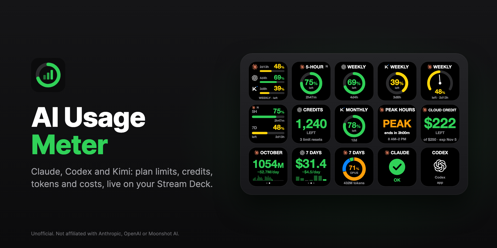
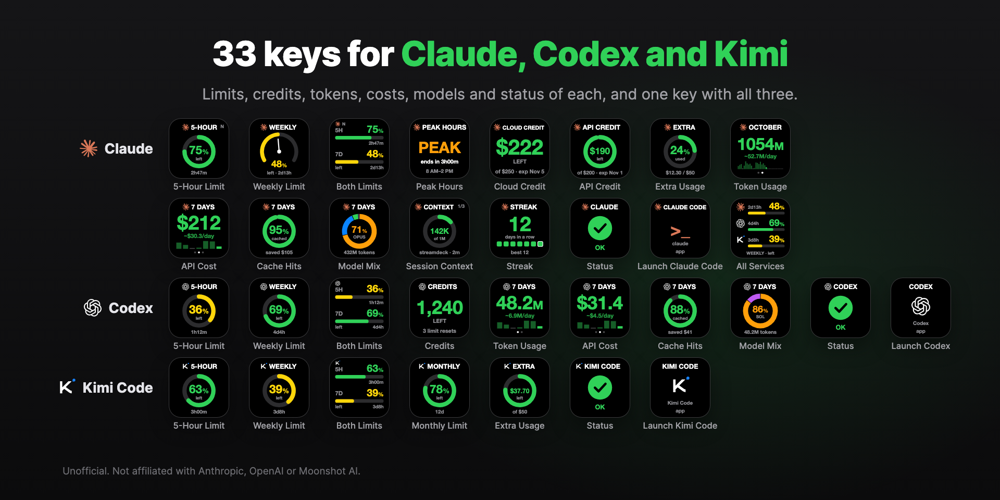
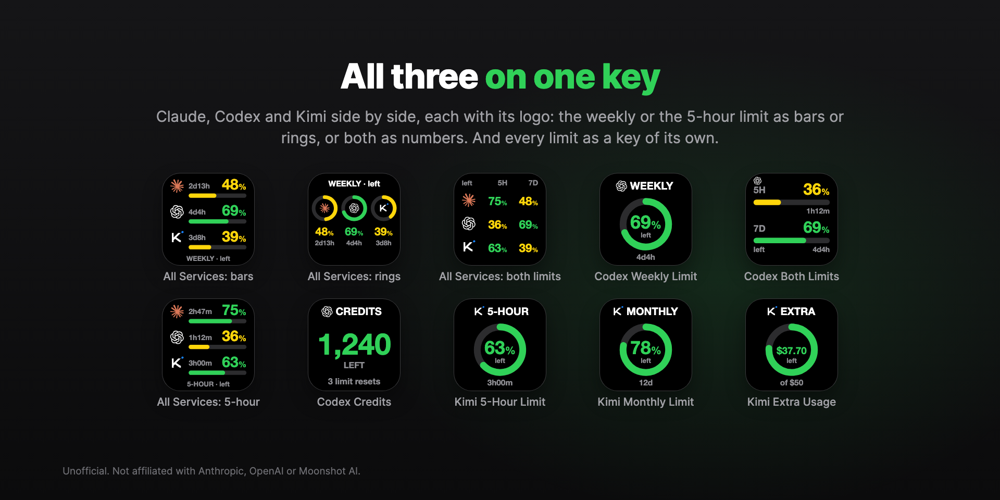
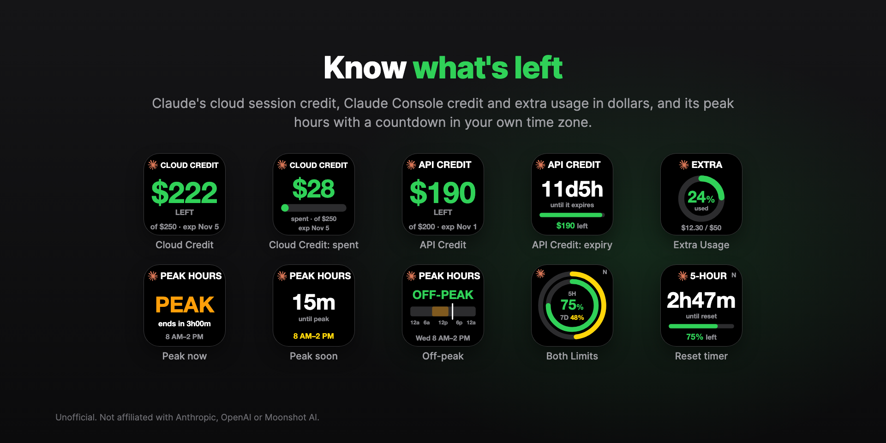
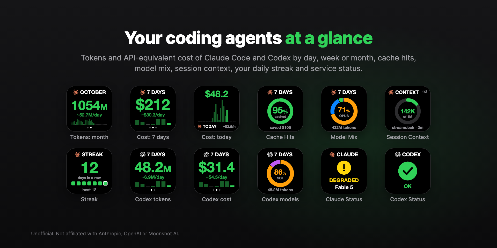
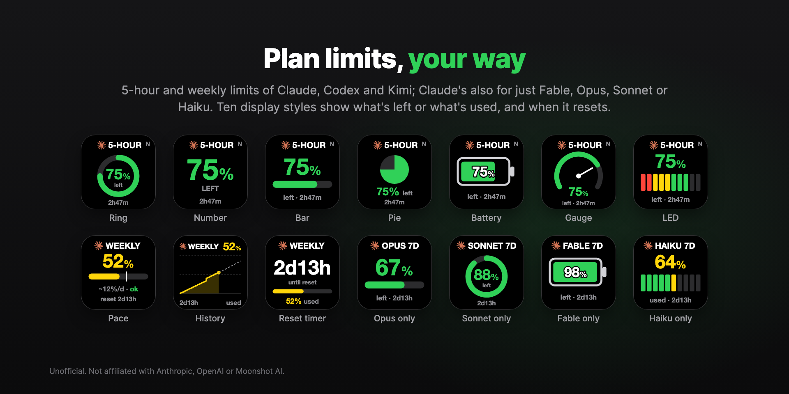
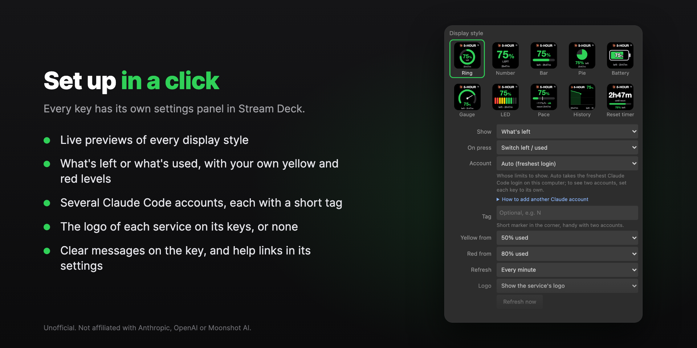

# AI Usage Meter

Ліміти ваших AI-інструментів на Stream Deck. Один плагін, 33 кнопки, три сервіси: **Claude**, **Codex** і **Kimi Code**. Видно, скільки лишилось у кожному плані до того, як ви впретесь у ліміт, скільки ця робота коштувала б через API і чи працює сервіс.



**[Завантажити AI Usage Meter](https://github.com/developerscompany/ai-usage-meter/releases/latest/download/agency.rivo.ai-usage-meter.streamDeckPlugin)** · [Усі релізи](https://github.com/developerscompany/ai-usage-meter/releases) · [Що нового](CHANGELOG.md) · [English](README.md)

> Неофіційний плагін від [Rivo Agency](https://rivo.agency). З Anthropic, OpenAI і Moonshot AI не пов'язаний. До версії 4.0 називався Usage Meter for Claude.

## Зміст

- [Що ви отримуєте](#що-ви-отримуєте)
- [Встановлення](#встановлення)
- [Що потрібно кожному сервісу](#що-потрібно-кожному-сервісу)
- [Кнопки](#кнопки)
- [Стилі й логотипи](#стилі-й-логотипи)
- [Налаштування кнопки](#налаштування-кнопки)
- [Звідки беруться цифри](#звідки-беруться-цифри)
- [Налаштування входів](#налаштування-входів)
- [Що означають написи на кнопках](#що-означають-написи-на-кнопках)
- [Запитання й відповіді](#запитання-й-відповіді)
- [Приватність](#приватність)
- [Що далі](#що-далі)
- [Розробка](#розробка)

## Що ви отримуєте



- **Ліміти плану** Claude, Codex і Kimi Code: 5-годинний і тижневий, скільки лишилось або використано і час до скидання. Десять стилів, від кільця до графіка історії.
- **All Services**: три сервіси поруч на одній кнопці.
- **Гроші**: кредит Claude за хмарні сесії, кредит у Claude Console та extra usage; кредити Codex; гаманець доплат Kimi.
- **Токени й вартість** Claude Code і Codex на цьому комп'ютері за день, тиждень чи місяць за цінами API; кеш і частка моделей.
- **Стан** кожного сервісу з його публічної сторінки статусу, і кнопки, що **запускають** Claude Code, Codex чи Kimi Code.
- **Логотип** сервісу на кожній кнопці: ліміт Claude з одного погляду відрізняється від ліміту Codex.

Усе працює на вашому комп'ютері. Плагін читає входи, які ваші інструменти вже зберігають, питає в кожного сервісу ваші цифри і нікуди більше нічого не надсилає.

## Встановлення

1. Завантажте **[`agency.rivo.ai-usage-meter.streamDeckPlugin`](https://github.com/developerscompany/ai-usage-meter/releases/latest/download/agency.rivo.ai-usage-meter.streamDeckPlugin)** з останнього релізу.
2. Двічі клацніть файл. Stream Deck встановить плагін. Наступні версії ставляться так само, і вже поставлені кнопки зберігають налаштування.
3. У списку дій Stream Deck відкрийте категорію **AI Usage Meter** і перетягніть потрібні кнопки на Stream Deck.
4. Клацніть кнопку, щоб відкрити її налаштування. Угорі сітка живих прев'ю всіх стилів: досить клацнути потрібний.

**Вимоги:** Stream Deck 6.9 або новіший, macOS 12+ або Windows 10+. Плагін перевірено на macOS; підтримка Windows є в коді, але на справжньому ПК її ще не пробували.

**Переходите з Usage Meter for Claude 3.x** (або Rivo Claude Usage 2.x)? У AI Usage Meter новий ідентифікатор, тож Stream Deck ставить його поруч зі старим плагіном, а не замість нього. Кнопки один раз додайте заново з нової категорії **AI Usage Meter**, а старий плагін видаліть: правою кнопкою на ньому в списку плагінів Stream Deck → **Uninstall**. Admin-ключ, уже покладений у зв'язку ключів під старою назвою, плагін і далі знайде.

## Що потрібно кожному сервісу

Кнопка працює, щойно її сервіс увійшов на цьому самому комп'ютері. У сам плагін нічого вводити не треба.

| Сервіс | Що має бути на цьому комп'ютері | Що ви отримуєте |
| --- | --- | --- |
| **Claude** | [Claude Code](https://code.claude.com/docs/en/setup) із входом на плані Pro або Max | ліміти, кредити й extra usage акаунта; токени, вартість, кеш, моделі, контекст і серія з логів Claude Code |
| **Codex** | Codex (застосунок або CLI) із входом через акаунт ChatGPT | ліміти й кредити акаунта; токени, вартість, кеш і моделі з логів Codex |
| **Kimi Code** | застосунок Kimi Code із входом або API-ключ Kimi Code, [покладений для плагіна](#вхід-kimi-code) | ліміти й доплати акаунта |

Потрібні лише ті сервіси, якими ви користуєтесь: кнопка ненастроєного сервісу так і напише, решті це не заважає.

## Кнопки

У списку дій Stream Deck кожна кнопка названа разом зі своїм сервісом: **Claude 5-Hour Limit**, **Codex Weekly Limit**, **Kimi Monthly Limit**. Коротке натискання робить те, що в таблиці (більшість змінюється в полі **On press**); якщо кнопку трохи потримати, вона оновиться.

### Усі сервіси



| Кнопка | Що показує | Натискання | Утримання |
| --- | --- | --- | --- |
| **All Services** | Claude, Codex і Kimi на одній кнопці, по рядку на сервіс: тижневий або 5-годинний ліміт смугами чи кільцями, або обидва ліміти числами | перемкнути «лишилось / використано» або «тиждень / 5 годин» | оновити |

Помаранчева крапка біля логотипа означає, що вхід цього сервісу потребує уваги; тьмяний рядок — що його цифри вже не актуальні. Які сервіси показувати, вибирається в полі **Services**.

### Claude

| Кнопка | Що показує | Натискання | Утримання |
| --- | --- | --- | --- |
| **5-Hour Limit** | 5-годинний ліміт: скільки лишилось або використано, час до скидання | перемкнути «лишилось / використано» | оновити |
| **Weekly Limit** | тижневий ліміт: усі моделі або окремо Fable, Opus, Sonnet, Haiku | те саме | оновити |
| **Both Limits** | 5-годинний і тижневий ліміти на одній кнопці | те саме | оновити |
| **Peak Hours** | чи зараз час пік (будні 5–11 ранку за тихоокеанським часом) і коли він закінчиться чи почнеться, за вашим часом | наступний стиль | — |
| **Cloud Credit** | кредит за хмарні сесії Claude Code на вашому плані: скільки доларів лишилось і коли він згорить | перемкнути «лишилось / витрачено» | оновити |
| **API Credit** | кредит у Claude Console (наприклад, промокредит $200 для API): скільки лишилось після витрат API | перемкнути «лишилось / витрачено» | оновити |
| **Extra Usage** | скільки extra usage витрачено цього місяця з ліміту | відкрити сторінку usage на claude.ai | оновити |
| **Token Usage** | токени Claude Code за сьогодні / 7 днів / місяць, у мільйонах | наступний період | пересканувати |
| **API Cost** | скільки це використання коштувало б за цінами API | наступний період | пересканувати |
| **Cache Hits** | яка частка вхідних токенів узята з кешу і скільки це заощадило за цінами API | наступний період | пересканувати |
| **Model Mix** | частка Fable / Opus / Sonnet / Haiku | наступний період | пересканувати |
| **Session Context** | наскільки заповнений контекст останніх сесій Claude Code | наступна сесія | пересканувати |
| **Streak** | скільки днів поспіль ви працюєте з Claude Code | наступний стиль | пересканувати |
| **Claude Status** | стан сервісів зі status.claude.com і модель, з якою проблема (наприклад `DEGRADED · Fable 5`) | відкрити поточний інцидент або сторінку статусу | оновити |
| **Launch Claude Code** | відкриває термінал із `claude` у вибраній папці, з будь-яким вашим акаунтом | запустити | — |



### Codex

| Кнопка | Що показує | Натискання | Утримання |
| --- | --- | --- | --- |
| **5-Hour Limit** | 5-годинний ліміт Codex на вашому плані ChatGPT; `not on your plan`, якщо в плану є лише тижневий | перемкнути «лишилось / використано» | оновити |
| **Weekly Limit** | тижневий ліміт Codex | те саме | оновити |
| **Both Limits** | обидва на одній кнопці | те саме | оновити |
| **Credits** | кредити, куплені понад план, і скільки скидань ліміту (limit resets) можна витратити | відкрити сторінку usage Codex | оновити |
| **Token Usage** | токени Codex за сьогодні / 7 днів / місяць | наступний період | пересканувати |
| **API Cost** | скільки це використання коштувало б за цінами API OpenAI | наступний період | пересканувати |
| **Cache Hits** | яка частка вхідних токенів узята з кешу і скільки це заощадило | наступний період | пересканувати |
| **Model Mix** | частка кожного сімейства моделей (Sol, Astra, Terra, Luna) | наступний період | пересканувати |
| **Codex Status** | стан Codex зі status.openai.com, або всього OpenAI, ChatGPT чи API | відкрити інцидент або сторінку статусу | оновити |
| **Launch Codex** | відкриває застосунок Codex (Mac) або термінал із `codex` у вибраній папці | запустити | — |

### Kimi Code

| Кнопка | Що показує | Натискання | Утримання |
| --- | --- | --- | --- |
| **5-Hour Limit** | 5-годинний ліміт вашого плану Kimi Code | перемкнути «лишилось / використано» | оновити |
| **Weekly Limit** | тижневий ліміт | те саме | оновити |
| **Both Limits** | обидва на одній кнопці | те саме | оновити |
| **Monthly Limit** | місячний ліміт плану Kimi, спільний для Kimi Code і чату Kimi | те саме | оновити |
| **Extra Usage** | гаманець доплат понад план: скільки в ньому лишилось або скільки витрачено цього місяця з вашої межі | те саме | оновити |
| **Kimi Status** | стан Kimi Code зі status.moonshot.cn, або всього Moonshot AI чи API | відкрити інцидент або сторінку статусу | оновити |
| **Launch Kimi Code** | відкриває застосунок Kimi Code (Mac) або термінал із `kimi` у вибраній папці | запустити | — |

Кнопок токенів для Kimi ще немає: див. [що далі](#що-далі).



## Стилі й логотипи



У кнопок лімітів 10 стилів: кільце, число, смуга, пиріг, батарейка, спідометр, LED-шкала, темп, історія і таймер скидання.

- **Темп** показує швидкість витрати (%/год або %/день). Вертикальна мітка на смузі показує, де ви «мали б» бути при рівномірній витраті. Підпис «ok / tight / fast» каже, чи вистачить ліміту до скидання; якщо ні, з'являється «limit in 1h12m».
- **Історія** малює графік витрати за поточне вікно і пунктиром продовжує його до скидання.
- У Both Limits 4 стилі, у All Services 3, у Cloud Credit і API Credit по 8 (усі, крім темпу та історії), у Cache Hits 5, у Peak Hours 3 (табличка, таймер, доба), у Streak 2 (дні, календар), у токенів і вартості 3, у моделей 3, у статусу 2.
- Колір залежить від витраченого: зелений, потім жовтий (за замовчуванням від 50%), потім червоний (від 80%). Пороги змінюються в налаштуваннях.

На кожній кнопці перед написом стоїть логотип її сервісу. Поле **Logo** в налаштуваннях кнопки його вимикає; кнопка All Services тоді показує по дві літери на сервіс.

Усі кнопки та стилі на одному аркуші: [docs/gallery.png](docs/gallery.png).

## Налаштування кнопки



Клацніть кнопку в застосунку Stream Deck, щоб відкрити її налаштування:

- **Display style**: живі прев'ю з вашими цифрами; клацніть потрібний стиль.
- **Show**: скільки лишилось або скільки використано. **On press**: що робить коротке натискання.
- **Yellow from** і **Red from**: ваші пороги попередження.
- **Account** (кнопки Claude): який акаунт Claude показує кнопка, і коротка мітка **Tag** у куті, щоб розрізняти два акаунти.
- **Logo**: з логотипом сервісу чи без.
- Під налаштуваннями: поточні цифри, час оновлення, який вхід використано (але не сам вхід), повний текст помилки і посилання на довідку.

## Звідки беруться цифри

Цифри бувають двох видів, і корисно знати, які де.

**Для всього акаунта, від самого сервісу.** Ліміти, кредити й extra usage. У них враховано всі ваші комп'ютери і застосунки самого сервісу.

| Сервіс | Запит | З яким входом |
| --- | --- | --- |
| Claude | `GET https://api.anthropic.com/api/oauth/usage`, той самий, що робить команда `/usage` у Claude Code | вхід Claude Code |
| Codex | `GET https://chatgpt.com/backend-api/wham/usage`, той самий, що робить панель usage застосунку Codex | вхід Codex через ChatGPT |
| Kimi Code | `GET <api>/coding/v1/usages` на `api.kimi.com` або `api.kimi.ai`, той самий, що робить панель usage застосунку Kimi Code | збережений API-ключ або вхід застосунку |

Який із лімітів плану Codex 5-годинний, а який тижневий, плагін визначає за тривалістю вікна. Тому план лише з тижневим лімітом показує його на кнопці Weekly, а на 5-Hour пише `not on your plan`.

**Лише для цього комп'ютера, з логів інструмента.** Токени, вартість, кеш, моделі, контекст сесії та серія. Ні Anthropic, ні OpenAI не публікують лічильники токенів за моделями для акаунтів на підписці, тож ці цифри можна взяти лише в самих інструментів.

- **Claude Code**: `~/.claude/projects` і папки профілів `~/.claude-*`. Кожна відповідь моделі враховується один раз, повтори склеюються за `message.id`. Щоб додати інші комп'ютери, копіюйте їхню папку `~/.claude/projects` у папку на кшталт `~/.claude-laptop/projects` на цьому комп'ютері, наприклад через [Syncthing](https://syncthing.net): папки `~/.claude-*` плагін знаходить сам. Чати на claude.ai і в застосунку Claude сюди не потрапляють, бо їхніх логів на комп'ютері немає.
- **Codex**: `~/.codex/sessions` і `~/.codex/archived_sessions`. Кожна відповідь враховується один раз, за записом, який Codex для неї робить. Старіші логи сесій Codex стискає (`.jsonl.zst`), а Node.js 20, яким Stream Deck запускає плагіни, відкрити їх не може: у налаштуваннях кнопки тоді написано, скільки логів не прочитано, і суми охоплюють лише свіжі сесії.

**Вартість** рахується за прайсами API Anthropic (жовтень 2026) та OpenAI (листопад 2026), з урахуванням запису в кеш і читання з нього та довгого контексту, а для Claude ще fast mode і вебпошуку. Це не ваш рахунок за підписку, а оцінка того, скільки те саме коштувало б через API. Модель без ціни в прайсі, наприклад `codex-auto-review` у Codex, йде в токени, але не в долари.

**Кеш.** Cache Hits показує, яка частка вхідних токенів (input, запис у кеш і читання з кешу разом) прочитана з кешу, і скільки ці читання заощадили проти повної ціни input за прайсом API. Запис у кеш коштує дорожче, і тут це не віднімається. Колір: зелений від 70%, жовтий від 40%, нижче — червоний.

**Серія.** Streak рахує дні поспіль, коли Claude Code на цьому комп'ютері зробив хоча б один запит. Поки сьогодні запитів не було, вчорашня серія ще жива і кнопка оранжева; зелена — коли сьогоднішній день уже зараховано. Плагін тримає останні 40 днів, тож довша серія показується як «40+».

**Стан сервісу** береться з публічних сторінок статусу: status.claude.com, status.openai.com і status.moonshot.cn. Якщо інцидент Claude стосується конкретної моделі, кнопка її називає: `DEGRADED · Fable 5`. У полі **Watch** можна стежити за всім сервісом або за окремою його частиною.

## Налаштування входів

### Вхід Claude Code

Плагін читає вхід, який зберігає Claude Code: на macOS зі зв'язки ключів (елемент `Claude Code-credentials`), в інших системах з `~/.claude/.credentials.json`. Під час першого читання macOS може запитати дозвіл: натисніть «Always Allow» («Дозволяти завжди»).

У режимі **Auto** (за замовчуванням) плагін переглядає всі входи Claude Code на комп'ютері і бере найсвіжіший. Який вхід знайдено і до якого часу він дійсний, видно в налаштуваннях кнопки в рядку **Login**.

Строк дії входу обмежений, і оновлює його тільки сама програма `claude`, коли надсилає запит. Якщо на цьому комп'ютері день не запускали Claude Code, вхід спливає. Тоді кнопки блякнуть, а внизу помаранчевим з'являється `login expired`. Запустіть `claude` на цьому комп'ютері (або натисніть **Launch Claude Code**) і надішліть будь-яке повідомлення: за хвилину кнопки оживуть, а якщо затиснути кнопку, то одразу.

### Вхід Codex

Кнопки Codex читають вхід, який Codex зберігає в `~/.codex/auth.json` (або `$CODEX_HOME/auth.json`), коли ви входите акаунтом ChatGPT у застосунку Codex чи командою `codex login`. Вхід діє близько десяти днів, і Codex сам оновлює його під час роботи; якщо він сплив, відкрийте Codex і надішліть будь-яке повідомлення.

Codex, налаштований тільки на API-ключ, лімітів плану не має. Вхід, який Codex тримає в системній зв'язці ключів замість файлу, плагін не читає.

### Вхід Kimi Code

Підходить будь-який із двох входів, і обидва плагін лише читає:

- **API-ключ Kimi Code** (радимо). Створіть його в консолі Kimi Code і покладіть для плагіна. На macOS виконайте в Terminal (ключ вставте, коли спитає):
  ```sh
  security add-generic-password -a "$USER" -s "AI Usage Meter Kimi API Key" -w
  ```
  На Windows збережіть його єдиним рядком у файлі `%APPDATA%\agency.rivo.ai-usage-meter\kimi-api-key`. Ключ не спливає, тож цифри завжди актуальні.
- **Вхід застосунку Kimi Code** з `~/.kimi-code/credentials`, без жодних налаштувань. Він діє 15 хвилин, і Kimi Code оновлює його лише під час роботи: невдовзі після того, як ви перестали працювати в Kimi Code, кнопки тьмяніють і пишуть `login expired`, доки ви знову ним не скористаєтесь.

Кроки для вашого комп'ютера, який вхід зараз використовується і посилання на консоль вашого регіону показано в налаштуваннях кнопки.

### Кілька акаунтів Claude

Кожен акаунт Claude живе у своєму профілі Claude Code, тобто у своїй папці:

1. У Terminal запустіть `CLAUDE_CONFIG_DIR=~/.claude-work claude` (на Windows у Command Prompt: `set "CLAUDE_CONFIG_DIR=%USERPROFILE%\.claude-work" && claude`).
2. Коли Claude Code попросить, увійдіть в інший акаунт (або наберіть `/login`).
3. У налаштуваннях кнопки в полі **Account** виберіть `~/.claude-work`. Профіль з'являється в списку сам, разом з email акаунта, тож видно, де чий.

На кожну кнопку поставте свій акаунт і свою мітку в полі **Tag**, наприклад «N» і «W». Auto завжди бере найсвіжіший вхід, тож для двох акаунтів поруч він не підходить. Кнопка **Launch Claude Code** з тим самим акаунтом відкриває його одним натисканням і заодно тримає вхід свіжим.

Окремого входу «через Claude» в самому плагіні немає: Anthropic не дає стороннім програмам власного входу в акаунти Claude, а токен, який видає `claude setup-token`, не має доступу до даних про ліміти. Тому плагін бере вхід лише з профілів Claude Code і нічого не зберігає сам.

### Кредит за хмарні сесії

Кнопка **Cloud Credit** показує грошовий кредит за хмарні сесії Claude Code: на claude.ai в Settings → Usage він виглядає як «Cloud session credits: $203 of $250 left, Expires November 4». Зараз Anthropic показує його тільки на claude.ai і в застосунку Claude; API, через яке працюють Claude Code і плагін, його не надсилає. Поки так, кнопка пише `only on claude.ai`, а натискання відкриває сторінку Usage. Коли API почне його надсилати, кнопка сама покаже суму, без оновлення плагіна. У налаштуванні **Credit** замість нього можна вибрати кредит Claude Code і Cowork, який API надсилає у відсотках.

### Кредит у Claude Console (API Credit)

Це окремі гроші: кредит організації в Claude Console, наприклад промокредит $200 для API. Окремого API для цього балансу Anthropic не має, тож кнопка віднімає від нарахованої суми витрати API з дня нарахування, які бере з Usage and Cost Admin API:

1. У [Claude Console](https://platform.claude.com/settings/admin-keys) створіть Admin-ключ (`sk-ant-admin01-…`).
2. На macOS покладіть його у зв'язку ключів (ключ вставте, коли спитає):
   ```sh
   security add-generic-password -a "$USER" -s "AI Usage Meter Admin Key" -w
   ```
   На Windows збережіть його єдиним рядком у файлі `%APPDATA%\agency.rivo.ai-usage-meter\admin-key`; точний шлях показано в налаштуваннях кнопки.
3. У налаштуваннях кнопки впишіть суму і дати з Billing → Promotional credits: наприклад `200`, `2026-10-18` і `2026-11-01` (дати в UTC, як у Console).

Без суми кнопка показує витрати API за поточний місяць. Admin-ключ дає права адміністратора організації, тож тримайте його лише у зв'язці ключів; відкликати його можна будь-коли в Console.

### Години пік і формат часу

Anthropic запровадила години пік 26 березня 2026: у будні з 5 до 11 ранку за тихоокеанським часом 5-годинні ліміти сесій витрачаються швидше. З 6 травня 2026 це вже не стосується Claude Code на планах Pro і Max. Кнопка **Peak Hours** рахує розклад сама, з урахуванням переходу США на літній і зимовий час, і показує його за вашим часом: у Києві це 15:00–21:00. Поле **Warn before** заздалегідь фарбує кнопку жовтим («SOON»).

24 години чи AM/PM плагін бере з регіону вашого комп'ютера, а не з мови. У налаштуваннях Peak Hours формат можна вибрати й вручну (**Clock**).

### Запуск Claude Code, Codex і Kimi Code

Кнопка **Launch Claude Code** відкриває вікно Terminal (або iTerm) і запускає в ньому команду, за замовчуванням `claude`, у вибраній папці і з вибраним акаунтом. Кнопки **Launch Codex** і **Launch Kimi Code** на Mac відкривають застосунок, а якщо в полі **Open** вибрати термінал (на Windows це єдиний варіант), запускають команду `codex` або `kimi` у вибраній папці.

## Що означають написи на кнопках

| Напис | Значення |
| --- | --- |
| `no Claude login / run claude` | для цього акаунта не знайдено входу в Claude Code |
| `login expired / run claude` | знайдений вхід сплив: запустіть `claude` і надішліть будь-яке повідомлення |
| `no Codex login / open Codex` | на цьому комп'ютері Codex не ввійшов акаунтом ChatGPT |
| `no Kimi login / open Kimi Code` | не знайдено ні входу Kimi Code, ні збереженого API-ключа |
| `login expired / open Kimi Code` | 15-хвилинний вхід застосунку Kimi Code сплив: попрацюйте в Kimi Code або покладіть API-ключ |
| `token refused` / `login refused` | сервіс не прийняв вхід; подробиці в налаштуваннях кнопки |
| `rate limited` / `offline` / `API error` | тимчасова проблема, плагін повторить пізніше |
| `not on your plan` | у плану немає такого ліміту (наприклад, окремого Haiku, або 5-годинного в плані Codex лише з тижневим) |
| `only on claude.ai / press to open` | API не надіслав кредит; натискання відкриє claude.ai/settings/usage |
| `no Claude Code use` | за цей період у логах немає запитів |
| `no Admin key / see settings` | кнопка API Credit не знайшла Admin-ключ |
| `key refused / see settings` | Admin API не прийняв ключ: потрібен саме Admin-ключ тієї організації, чий кредит показуєте |
| бліді цифри, внизу `login expired` | це останні цифри до того, як вхід сплив: попрацюйте в інструменті на цьому комп'ютері |
| бліді цифри, внизу `3h old` | плагін стільки часу не міг їх оновити; причина в налаштуваннях кнопки |
| кружечок у лівому верхньому куті | останнє оновлення не вдалося; цифрам може бути кілька хвилин |
| помаранчева крапка біля логотипа, тьмяний рядок (All Services) | вхід цього сервісу потребує уваги; його цифри вже не актуальні |

Лог плагіна на macOS: `~/Library/Application Support/com.elgato.StreamDeck/Plugins/agency.rivo.ai-usage-meter.sdPlugin/logs/plugin.log`. Входів у ньому не буває.

## Запитання й відповіді

**Чи потрібні всі три сервіси?** Ні. Додайте кнопки тих сервісів, якими користуєтесь. Кнопка All Services показує ті, що позначені в полі **Services**.

**Кнопки Kimi майже завжди пишуть `login expired`.** Це 15-хвилинний вхід застосунку спливає між вашими сесіями. Покладіть [API-ключ Kimi Code](#вхід-kimi-code), і цифри будуть актуальні завжди.

**Кнопка Codex 5-Hour пише `not on your plan`.** Деякі плани ChatGPT дають Codex лише тижневий ліміт. Користуйтесь кнопкою Weekly; які ліміти є у вашого плану, видно в налаштуваннях кнопки.

**Токени Codex виглядають заниженими.** Codex стискає старіші логи сесій, а відкрити їх плагін поки не може. Скільки логів не прочитано, написано в налаштуваннях кнопки. Див. [що далі](#що-далі).

**Чи рахують кнопки токенів те, що я роблю на іншому комп'ютері чи у вебзастосунках?** Ні, лише логи цього комп'ютера. Кнопки лімітів рахують: ці цифри дає сам сервіс.

**Чи можна сховати логотипи?** Так, для кожної кнопки окремо: поле **Logo** в її налаштуваннях.

**Як часто оновлюються цифри?** За замовчуванням щохвилини (поле **Refresh**); потримайте кнопку, щоб оновити зараз. Перемикання сторінок Stream Deck нових запитів до сервісів не робить.

**Чи працює на Windows?** Код для цього є, і тести його покривають, але на справжньому ПК плагін ще не пробували. Будемо раді відгукам.

## Приватність

- Усе працює на вашому комп'ютері: без аналітики, телеметрії та наших серверів.
- Плагін звертається лише до `api.anthropic.com` і `status.claude.com`; з кнопками Codex ще до `chatgpt.com` і `status.openai.com`; з кнопками Kimi ще до `api.kimi.com` або `api.kimi.ai` і `status.moonshot.cn`.
- Входи Claude Code, Codex і Kimi Code та ключі (Admin-ключ, API-ключ Kimi) плагін лише читає: не оновлює, не копіює, не пише в лог і не показує в налаштуваннях. Кожен надсилається тільки тому сервісу, якому належить, без переходів за перенаправленнями.
- Останні значення та коротка історія для стилю «Історія» зберігаються в папці даних плагіна (`~/Library/Application Support/agency.rivo.ai-usage-meter` на macOS).

Докладно: [PRIVACY.md](PRIVACY.md). Про проблему безпеки напишіть, як описано в [SECURITY.md](SECURITY.md).

## Що далі

- **Токени й вартість Kimi.** У логах сесій Kimi Code (`wire.jsonl`) є лічильники токенів, але формат треба звірити зі справжніми сесіями, перш ніж будувати на ньому кнопки.
- **Стиснуті логи Codex.** Щоб читати `.jsonl.zst`, потрібен або Node.js 24 у Stream Deck (тобто новіша мінімальна версія Stream Deck), або вбудований декодер.

Ідеї та повідомлення про помилки чекаємо в [issues](https://github.com/developerscompany/ai-usage-meter/issues).

## Розробка

Потрібен Node.js 20 або новіший.

```sh
npm install
npm run build        # src/ → agency.rivo.ai-usage-meter.sdPlugin/bin/plugin.js
npm test             # юніт-тести, плагін цілком проти несправжніх Stream Deck і API, панель налаштувань
npm run pack         # перевірка маніфесту і збирання dist/agency.rivo.ai-usage-meter.streamDeckPlugin
npm run icons        # іконки плагіна, категорії та дій (PNG)
npm run marketplace  # зображення для цього README і для лістингу, у marketplace/
node scripts/gallery.mjs   # docs/gallery.png з усіма кнопками і стилями
```

Тести панелі налаштувань і скрипти зображень потребують [Playwright](https://playwright.dev) із Chromium, встановленого глобально (`npm install -g playwright`); без нього ці тести пропускаються.

| Файл | Що всередині |
| --- | --- |
| `src/plugin.js` | ядро: кнопки, натискання й утримання, спільні джерела даних, прев'ю для налаштувань |
| `src/streamdeck.js` | зв'язок зі Stream Deck через офіційний SDK Elgato (`@elgato/streamdeck`), якого вимагає DRM на Marketplace |
| `src/providers.js` | три сервіси: звідки беруться ліміти й логи кожного |
| `src/actions/` | кнопки: налаштування за замовчуванням, малювання, дія на натискання, дані для панелі |
| `src/render/` | SVG-картинки (лише SVG Tiny: Stream Deck малює кнопки через Qt); у `logos.js` логотипи сервісів |
| `src/limits.js` | ліміти плану: запит, повтори, кеш та історія; ліміти Claude і кредит за хмарні сесії |
| `src/codex.js`, `src/kimi.js` | де Codex і Kimi Code зберігають вхід та їхні відповіді про usage (лише читання) |
| `src/login.js` | де Claude Code зберігає вхід і який зі знайдених узяти (лише читання) |
| `src/usage-index.js` | інкрементальне читання логів сесій (токени, вартість, моделі, години, сесії) і формат логів Claude Code |
| `src/codex-logs.js` | формат логів Codex |
| `src/pricing.js` | ціни моделей Claude та OpenAI |
| `src/console.js` | витрати API з Usage and Cost Admin API для кнопки API Credit (Admin-ключ лише читається) |
| `src/status.js` | стан сервісу зі status.claude.com, status.openai.com і status.moonshot.cn |
| `src/secrets.js`, `src/keychain.js` | обережність із входами й ключами: один чистий токен, ніколи в тексті помилки, зв'язка ключів macOS |
| `src/peak.js` | розклад годин пік за тихоокеанським часом, з літнім і зимовим часом США |
| `src/clock.js` | 24 години чи AM/PM: з налаштування кнопки або з регіону комп'ютера |
| `src/launch.js` | команда, що відкриває термінал із Claude Code, Codex чи Kimi Code або їхній застосунок на Mac |
| `agency.rivo.ai-usage-meter.sdPlugin/ui/` | спільна панель налаштувань для всіх кнопок |

## Ліцензія

[MIT](LICENSE) © Rivo Agency. Claude — торгова марка Anthropic, PBC. OpenAI, ChatGPT і Codex — торгові марки OpenAI. Kimi — торгова марка Moonshot AI. Elgato і Stream Deck — торгові марки Corsair Memory, Inc. Проєкт не пов'язаний із жодною з цих компаній; їхні логотипи на кнопках лише позначають сервіс, який показує кнопка, і на кожній кнопці логотип можна вимкнути.
